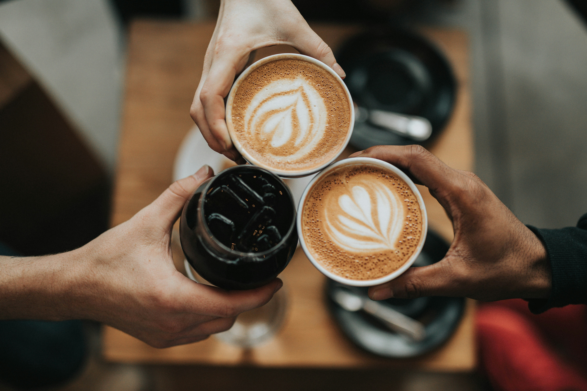
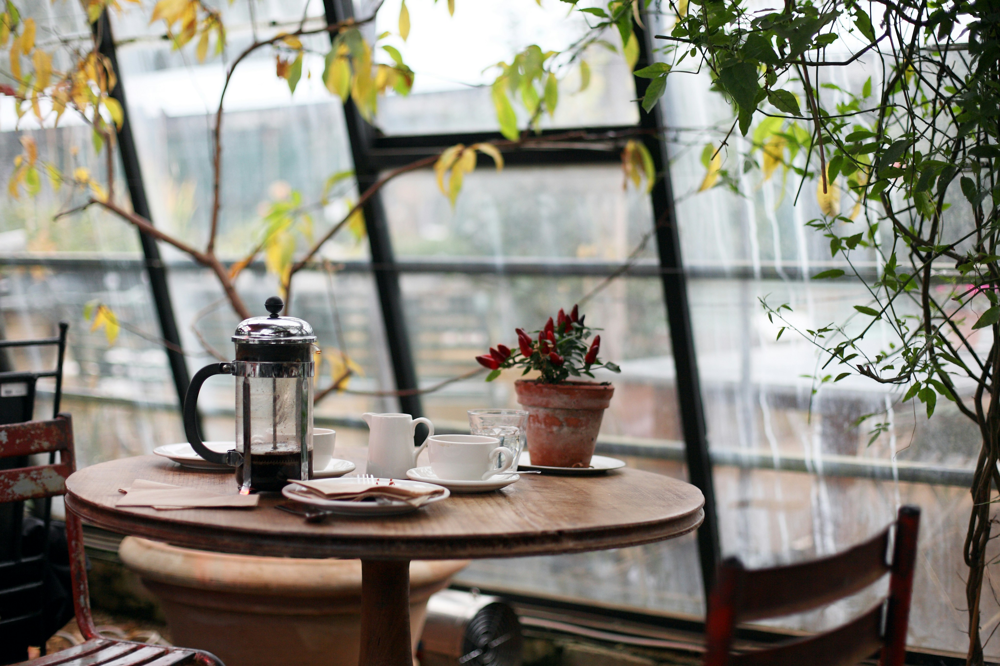
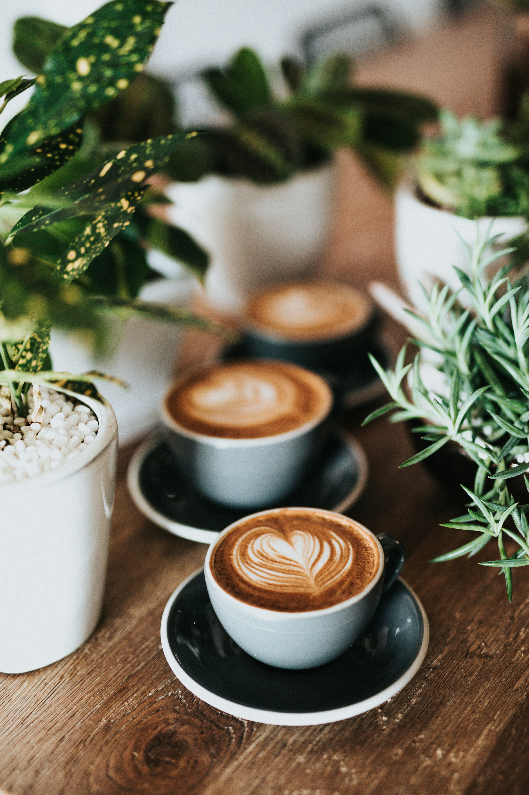
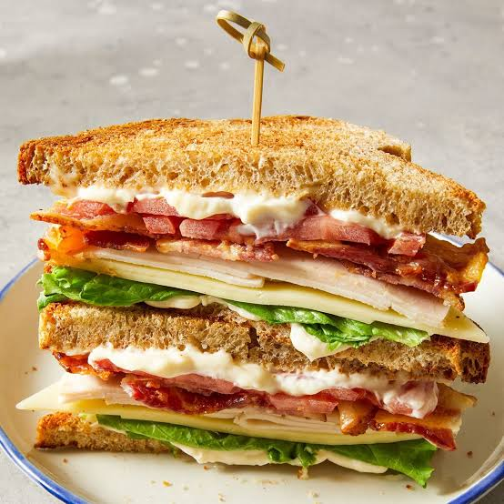
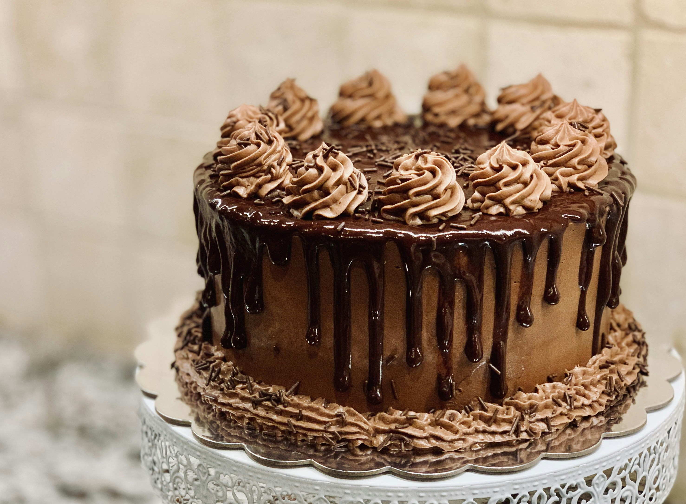
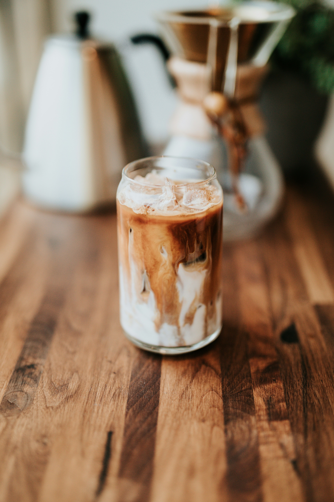

# Ex02 Commercial Website
## Date:02.11.2026

## AIM
To create a commercial website using CSS Flexbox.

## ALGORITHM
### STEP 1
Create an HTML file (index.html)

### STEP 2
Create a CSS file (style.css)

### STEP 3
Include a navigation bar with links to different sections.

### STEP 4
Add structured sections for Homepage, Products / Services, About Us, Contact Details and User Account.

### STEP 5
Include social media links at the footer with copyright information.

### STEP 6
Define global styles for fonts, colors, and layout.

### STEP 7
Style the header, navigation bar, and sections.

### STEP 8
Use Flexbox for layout design.

### STEP 9
Add hover effects and transitions for interactivity.

### STEP 10
Add Images and Media.

### STEP 11
Use optimized images for a professional look.

### STEP 12
Open the HTML file in a browser to check layout and functionality.

### STEP 13
Fix styling issues and refine content placement.

### STEP 14
Deploy the website.

### STEP 15
Upload to GitHub Pages for free hosting.

## PROGRAM
# index.html
```

<!DOCTYPE html>
<html lang="en">
<head>
    <meta charset="UTF-8">
    <meta name="viewport" content="width=device-width, initial-scale=1.0">

    <title>Corner Cafe | Coffee & Delicious Food</title>

    <link rel="stylesheet" href="style.css">

    <link href="https://fonts.googleapis.com/css2?family=Poppins:wght@400;500;600;700&display=swap" rel="stylesheet">
</head>

<body>

    <!-- Navigation Bar -->
    <header>
        <nav class="navbar">
            <h2 class="logo">Corner<span>Cafe.</span></h2>

            <ul class="nav-links" id="navLinks">
                <li><a href="#home">Home</a></li>
                <li><a href="#about">About</a></li>
                <li><a href="#menu">Menu</a></li>
                <li><a href="#contact">Contact</a></li>
            </ul>

            <button class="menu-btn" onclick="toggleMenu()">☰</button>
        </nav>
    </header>


    <!-- Home Section -->
    <section class="home" id="home">

        <div class="home-content">
            <h1>Welcome to <span>Corner Cafe</span></h1>

            <h2>Fresh Coffee & Delicious Food</h2>

            <p>
                Experience the perfect combination of delicious food,
                refreshing drinks and a beautiful atmosphere.
            </p>

            <a href="#menu" class="btn">Explore Menu</a>
        </div>

        <div class="home-image">
            
        </div>

    </section>


    <!-- About Section -->
    <section class="about" id="about">

        <h2 class="heading">About <span>Us</span></h2>

        <div class="about-content">

            

            <div>
                <h3>Welcome to Our Cafe</h3>

                <p>
                    Corner Cafe is a perfect place to enjoy delicious food,
                    freshly brewed coffee and unforgettable moments.
                    We serve quality food with love and care.
                </p>

                <p>
                    Visit us with your friends and family
                    and enjoy a wonderful cafe experience.
                </p>
            </div>

        </div>
    </section>


    <!-- Menu Section -->
    <section class="menu" id="menu">

        <h2 class="heading">Our <span>Menu</span></h2>

        <div class="menu-container">

            <div class="food-card">
                
                <h3>Hot Coffee</h3>
                <p>Freshly brewed coffee</p>
                <h4>₹120</h4>
                <button onclick="addToCart('Hot Coffee',120)">Add to Cart</button>
            </div>

            <div class="food-card">
                
                <h3>Sandwich</h3>
                <p>Fresh grilled sandwich</p>
                <h4>₹150</h4>
                <button onclick="addToCart('Sandwich',150)">Add to Cart</button>
            </div>

            <div class="food-card">
                
                <h3>Chocolate Cake</h3>
                <p>Delicious chocolate cake</p>
                <h4>₹110</h4>
                <button onclick="addToCart('Chocolate Cake',110)">Add to Cart</button>
            </div>

            <div class="food-card">
                
                <h3>Iced Coffee</h3>
                <p>Refreshing cold coffee</p>
                <h4>₹140</h4>
                <button onclick="addToCart('Iced Coffee',140)">Add to Cart</button>
            </div>

        </div>
    </section>


    <!-- Cart Section -->
    <section class="cart">

        <h2 class="heading">Your <span>Cart</span></h2>

        <div id="cart-items">
            Your cart is empty.
        </div>

        <h3>Total: ₹<span id="total">0</span></h3>

        <button class="order-btn" onclick="placeOrder()">
            Order on WhatsApp
        </button>

    </section>


    <!-- Contact Section -->
    <section class="contact" id="contact">

        <h2 class="heading">Contact <span>Us</span></h2>

        <div class="contact-content">
            <h3>Corner Cafe</h3>

            <p>📍 Anna road, Chennai</p>
            <p>📞 +91 7395831556</p>
            <p>✉ cornercafe@gmail.com</p>

            <p>Opening Hours: 9 AM - 10 PM</p>
        </div>

    </section>


    <!-- Footer -->
    <footer>
        <p>© 2026 Corner Cafe. All Rights Reserved.</p>
    </footer>


    <script src="script.js"></script>

</body>
</html>

```
# style.css
```

* {
    margin: 0;
    padding: 0;
    box-sizing: border-box;
    font-family: 'Poppins', sans-serif;
    scroll-behavior: smooth;
}

body {
    background: #fffaf3;
    color: #33251c;
}

/* Navbar */

header {
    background: #3b2418;
    padding: 20px 8%;
    position: sticky;
    top: 0;
    z-index: 100;
}

.navbar {
    display: flex;
    justify-content: space-between;
    align-items: center;
}

.logo {
    color: white;
    font-size: 28px;
}

.logo span {
    color: #e6a15c;
}

.nav-links {
    display: flex;
    list-style: none;
    gap: 30px;
}

.nav-links a {
    color: white;
    text-decoration: none;
    font-size: 16px;
}

.nav-links a:hover {
    color: #e6a15c;
}

.menu-btn {
    display: none;
    background: none;
    border: none;
    color: white;
    font-size: 25px;
}

/* Home */

.home {
    min-height: 90vh;
    display: flex;
    align-items: center;
    justify-content: space-around;
    padding: 50px 8%;
    gap: 40px;
}

.home-content {
    max-width: 550px;
}

.home-content h1 {
    font-size: 45px;
    margin-bottom: 15px;
}

.home-content h1 span {
    color: #b66b35;
}

.home-content h2 {
    margin-bottom: 15px;
    font-size: 25px;
}

.home-content p {
    color: #76675d;
    line-height: 1.8;
    margin-bottom: 25px;
}

.home-image img {
    width: 420px;
    height: 420px;
    object-fit: cover;
    border-radius: 50%;
}

.btn {
    display: inline-block;
    padding: 13px 28px;
    background: #b66b35;
    color: white;
    text-decoration: none;
    border-radius: 30px;
    transition: 0.3s;
}

.btn:hover {
    background: #3b2418;
}

/* Common Heading */

.heading {
    text-align: center;
    font-size: 35px;
    margin-bottom: 40px;
}

.heading span {
    color: #b66b35;
}

/* About */

.about {
    padding: 80px 8%;
    background: #f3e8d9;
}

.about-content {
    display: flex;
    align-items: center;
    gap: 50px;
}

.about-content img {
    width: 45%;
    height: 300px;
    object-fit: cover;
    border-radius: 15px;
}

.about-content h3 {
    font-size: 28px;
    margin-bottom: 15px;
}

.about-content p {
    line-height: 1.8;
    margin-bottom: 15px;
    color: #76675d;
}

/* Menu */

.menu {
    padding: 80px 8%;
}

.menu-container {
    display: grid;
    grid-template-columns: repeat(4, 1fr);
    gap: 25px;
}

.food-card {
    background: white;
    padding: 15px;
    border-radius: 15px;
    text-align: center;
    box-shadow: 0 5px 20px #00000012;
    transition: 0.3s;
}

.food-card:hover {
    transform: translateY(-10px);
}

.food-card img {
    width: 100%;
    height: 180px;
    object-fit: cover;
    border-radius: 10px;
}

.food-card h3 {
    margin: 12px 0;
}

.food-card p {
    color: #76675d;
    font-size: 14px;
}

.food-card h4 {
    color: #b66b35;
    margin: 12px;
    font-size: 20px;
}

.food-card button,
.order-btn {
    background: #3b2418;
    color: white;
    border: none;
    padding: 12px 20px;
    border-radius: 25px;
    cursor: pointer;
}

.food-card button:hover,
.order-btn:hover {
    background: #b66b35;
}

/* Cart */

.cart {
    padding: 70px 8%;
    text-align: center;
    background: #f3e8d9;
}

#cart-items {
    margin: 20px auto;
    max-width: 500px;
    line-height: 2;
}

.cart h3 {
    margin: 20px;
}

/* Contact */

.contact {
    padding: 80px 8%;
    text-align: center;
}

.contact-content {
    line-height: 2.5;
}

/* Footer */

footer {
    background: #3b2418;
    color: white;
    text-align: center;
    padding: 20px;
}

/* Responsive Design */

@media(max-width: 900px) {

    .menu-container {
        grid-template-columns: repeat(2, 1fr);
    }

    .home-image img {
        width: 320px;
        height: 320px;
    }
}

@media(max-width: 600px) {

    .menu-btn {
        display: block;
    }

    .nav-links {
        display: none;
        position: absolute;
        top: 75px;
        left: 0;
        width: 100%;
        background: #3b2418;
        flex-direction: column;
        padding: 20px;
    }

    .nav-links.active {
        display: flex;
    }

    .home {
        flex-direction: column;
        text-align: center;
    }

    .home-content h1 {
        font-size: 32px;
    }

    .home-image img {
        width: 280px;
        height: 280px;
    }

    .about-content {
        flex-direction: column;
    }

    .about-content img {
        width: 100%;
    }

    .menu-container {
        grid-template-columns: 1fr;
    }
}

```
# script.js
```

let cart = [];
let total = 0;

// Mobile Navigation

function toggleMenu() {

    let nav = document.getElementById("navLinks");

    nav.classList.toggle("active");

}


// Add Items to Cart

function addToCart(name, price) {

    cart.push({
        name: name,
        price: price
    });

    total = total + price;

    displayCart();

}


// Display Cart Items

function displayCart() {

    let cartItems = document.getElementById("cart-items");

    cartItems.innerHTML = "";

    cart.forEach(function(item, index) {

        cartItems.innerHTML += `
            <p>
                ${item.name} - ₹${item.price}
                <button onclick="removeItem(${index})">Remove</button>
            </p>
        `;

    });

    document.getElementById("total").innerText = total;

}


// Remove Items

function removeItem(index) {

    total = total - cart[index].price;

    cart.splice(index, 1);

    displayCart();

}


// WhatsApp Ordering

function placeOrder() {

    if (cart.length === 0) {

        alert("Please add food items to your cart!");

        return;

    }

    let message = "Hello Corner Cafe! I want to order:\n";

    cart.forEach(function(item) {

        message += item.name + " - ₹" + item.price + "\n";

    });

    message += "\nTotal Amount: ₹" + total;

    // Replace with your actual WhatsApp number
    let phone = "91XXXXXXXXXX";

    let url = "https://wa.me/" + phone +
              "?text=" + encodeURIComponent(message);

    window.open(url, "_blank");

}

```


## OUTPUT


## RESULT
The program for creating commercial website using CSS Flexbox is executed successfully.
